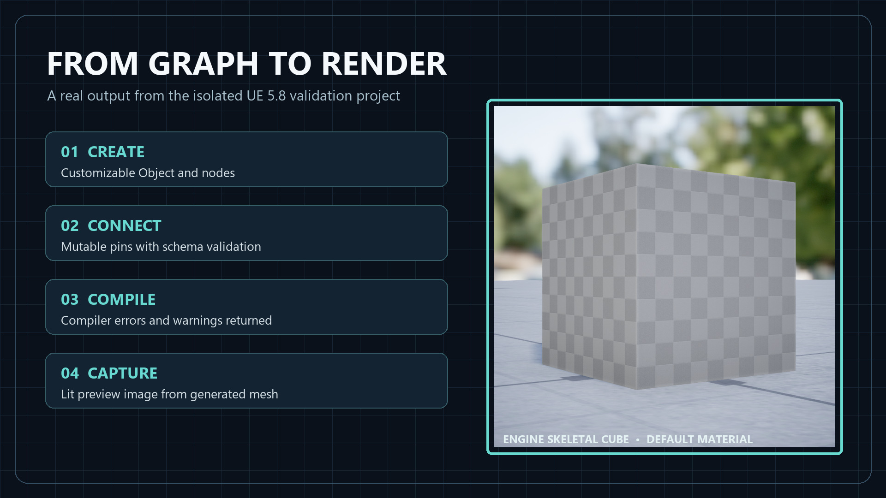
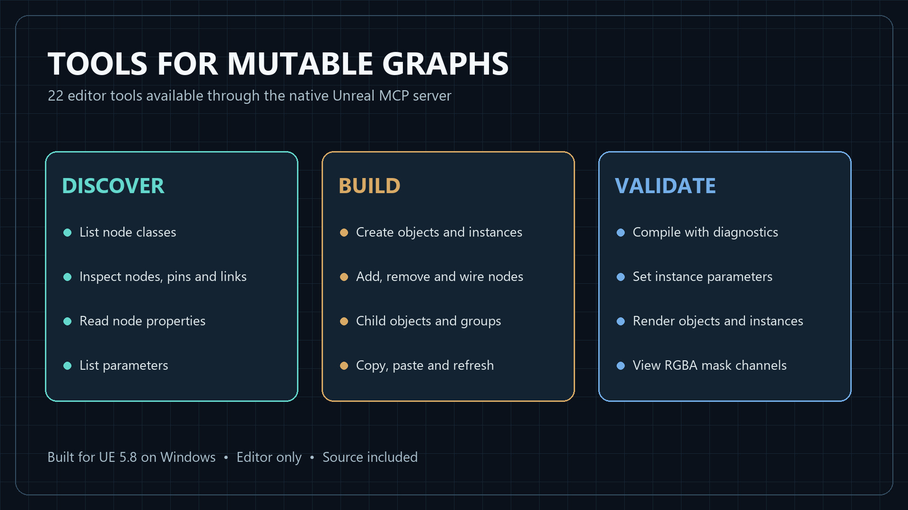

# Mutable Graph Toolset

An Unreal Engine editor plugin that lets AI agents build Mutable characters. Your assistant creates
Customizable Objects, places and wires nodes, adds child objects as options, compiles, sets
instance parameters and looks at rendered previews, all through the Model Context Protocol (MCP)
server that ships with Unreal Engine.

You describe what you want ("a character with three selectable jackets"), the agent builds the
graph, compiles it, reads the errors, fixes them and shows you the result. Everything it does is a
normal editor action: it shows up in the graph editor, can be undone with Ctrl+Z and is saved like
any other asset.



**[Get it on Fab](https://www.fab.com/listings/aa935747-f923-4d4f-aa23-1b2a8e8a196d)**

## Features

- 22 tools covering the whole Mutable workflow: assets, graph, connections, clipboard, compile,
  parameters, instances and previews
- Builds graphs with any Mutable node class, discovered at runtime, so new engine nodes work too
- Child objects and groups, the standard way to set up selectable clothing, hair or body options
- Reads compile errors and warnings back to the agent instead of hiding them in the log
- Lists parameters with their options and defaults; sets them on instance assets
- Renders the object or an instance in its own lit scene, from any angle, without opening an editor
- Shows the R, G, B and A channels of a texture, for checking clip and layer masks
- Every edit is an editor transaction: undo, redo and the dirty flag work as usual
- Safe by design: assets can only be created and saved in project content, inputs are validated
  before anything changes, image sizes and concurrent renders are capped
- 62 automation tests, plus an end-to-end run through the MCP server



## Requirements

- Unreal Engine 5.8 on Windows
- Engine plugins **Mutable**, **Toolset Registry** and **Model Context Protocol**
- An AI assistant or other client that can talk to an MCP server over HTTP

The plugin is editor-only. It adds nothing to packaged games.

## Set up with your AI assistant

The quickest way: copy the block below into the chat of your AI assistant (one that can run commands
and edit files on your computer, and connect to MCP servers). It checks your project, enables the
plugins, starts the server and connects itself.

```text
Please set up the "Mutable Graph Toolset" Unreal Engine plugin for me and connect yourself to it.

1. Find my Unreal project (.uproject). Ask me if there are several. It must use Unreal Engine 5.8.
2. Check that the plugin is installed: either in the engine (Engine/Plugins/Marketplace, installed
   from Fab) or as <Project>/Plugins/MutableGraphToolset. If it is missing, stop and tell me to
   install it from Fab first.
3. Enable these plugins in the .uproject "Plugins" list (add entries with "Enabled": true, keep
   everything else unchanged): MutableGraphToolset, Mutable, ToolsetRegistry, ModelContextProtocol.
4. The editor must run with its MCP server. Either launch it with the argument
   -ModelContextProtocolStartServer, or ask me to turn on the server's auto start in
   Project Settings > Plugins > Model Context Protocol and restart the editor.
   The default endpoint is http://127.0.0.1:8000/mcp.
5. Add that endpoint to your own MCP configuration as an HTTP (Streamable HTTP) server named
   "unreal", then reload your MCP servers if you need to.
6. Verify: call list_toolsets and confirm "MutableGraphToolset.MutableGraphToolset" is listed, then
   call describe_toolset for it.
7. Read the agent guide at
   https://github.com/ITemre/MutableGraphToolset/blob/main/AI_AGENT_HANDOFF.md
   (also shipped in the plugin as Documentation/AI_AGENT_HANDOFF.md) and follow its rules whenever
   you work with Mutable in this project.
8. Tell me in two sentences what is set up and what I can ask you to build.
```

If something does not work, see [Troubleshooting](#troubleshooting).

## Manual installation

1. Install **Mutable Graph Toolset** from Fab to Unreal Engine 5.8 with the Epic Games Launcher.
   To use it as a project plugin instead, copy the `MutableGraphToolset` folder to
   `YourProject/Plugins/` and build the project.
2. Open the project, go to **Edit > Plugins** and enable **Mutable Graph Toolset**, **Mutable**,
   **Toolset Registry** and **Model Context Protocol**. Restart the editor.
3. Start the MCP server: launch the editor with `-ModelContextProtocolStartServer`, or turn on auto
   start in **Project Settings > Plugins > Model Context Protocol**. The default endpoint is
   `http://127.0.0.1:8000/mcp`; the port can be changed on the same page.
4. Add the endpoint to your MCP client as an HTTP server. Most clients use a JSON entry like this:

   ```json
   {
     "mcpServers": {
       "unreal": { "type": "http", "url": "http://127.0.0.1:8000/mcp" }
     }
   }
   ```

   The editor can write this configuration for some clients: run
   `ModelContextProtocol.GenerateClientConfig <ClientName>` in the editor console.
5. Ask your assistant to list the toolsets. `MutableGraphToolset.MutableGraphToolset` should be one
   of them.

## How agents call the tools

Unreal's MCP server exposes all toolsets through three generic tools:

| MCP tool | Purpose |
| --- | --- |
| `list_toolsets` | Lists the registered toolsets |
| `describe_toolset` | Returns the tools of a toolset with descriptions and input schemas |
| `call_tool` | Runs a tool: `toolset_name`, `tool_name`, `arguments` |

Conventions:

- Argument names are the parameter names in lower camel case: `packagePath`, `fromNode`.
- Assets, nodes and classes are passed and returned as `{ "refPath": "<path>" }`, for example
  `{ "refPath": "/Game/Characters/CO_Hero.CO_Hero" }` or
  `{ "refPath": "/Script/CustomizableObjectEditor.CONodeComponentSkeletalMesh" }`.
- Graph positions are `{ "x": -300, "y": 0 }`.
- Results come back as JSON with a `returnValue` field.
- Invalid input fails the call with a message starting with `MutableGraphToolset:` that names the
  cause, for example the pins a node actually has when a pin name is wrong.

A complete `call_tool` request:

```json
{
  "jsonrpc": "2.0", "id": 2, "method": "tools/call",
  "params": {
    "name": "call_tool",
    "arguments": {
      "toolset_name": "MutableGraphToolset.MutableGraphToolset",
      "tool_name": "CreateObject",
      "arguments": { "packagePath": "/Game/Characters", "name": "CO_Hero" }
    }
  }
}
```

## Tools

### Assets

| Tool | What it does |
| --- | --- |
| `CreateObject(packagePath, name)` | Creates and saves a Customizable Object with a base object node. |
| `CreateInstance(object, packagePath, name)` | Creates and saves a Customizable Object Instance with default values. |
| `SaveAsset(asset)` | Saves a Customizable Object or Instance. |
| `SetParentObject(object, parentGroupNode)` | Makes an object an option of a Group Object node in another object. No group node detaches it. |

### Graph

| Tool | What it does |
| --- | --- |
| `ListNodeClasses(nameFilter)` | Lists placeable Mutable node classes, optionally filtered by name. |
| `ListNodes(object, bIncludeHiddenPins)` | Returns every node with pins and connections. |
| `GetNode(node, bIncludeHiddenPins)` | Returns one node with pins and connections. |
| `AddNode(object, nodeClass, position)` | Places a node, as from the graph's context menu. |
| `RemoveNode(node)` | Deletes a node and its connections. |
| `RefreshNode(node)` | Rebuilds a node's pins, like *Refresh Node* in the editor. |
| `GetNodeProperty(node, propertyName)` | Reads any node property in Unreal's text format. |
| `SetNodeProperty(node, propertyName, value)` | Writes a node property, including ones the Details panel hides. |
| `ConnectPins(fromNode, fromPin, toNode, toPin)` | Connects an output to an input, with the editor's own compatibility check. |
| `DisconnectPins(fromNode, fromPin, toNode, toPin)` | Removes a connection. |
| `ExportNodes(nodes)` | Copies nodes as clipboard text. |
| `ImportNodes(object, text, position)` | Pastes clipboard text, also from another object or from the editor. |

### Compile, parameters and preview

| Tool | What it does |
| --- | --- |
| `CompileObject(object)` | Compiles synchronously and returns success plus every warning and error. |
| `ListParameters(object)` | Parameters of a compiled object: name, type, options, default value. |
| `GetInstanceParameters(instance)` | The values an instance currently holds. |
| `SetInstanceParameter(instance, parameterName, value)` | Sets one parameter value on an instance. |
| `CaptureObjectPreview(object, viewYaw, focusHeight, zoom, width, height)` | Renders the object with default values. |
| `CaptureInstancePreview(instance, viewYaw, focusHeight, zoom, width, height)` | Renders an instance with its values; the asset is not changed. |
| `CaptureTextureChannels(texture, size)` | Shows R, G, B and A of a texture as a 2x2 grayscale grid. |

Camera arguments: `viewYaw` in degrees, 0 looks at the front (+Y, the MetaHuman forward axis);
`focusHeight` from 0 (lowest point) to 1 (highest); `zoom` 1 frames the whole object, 3 fills the
image with a third of its height. Defaults: yaw 0, focus 0.5, zoom 1, 1024 x 1536 pixels.

Node properties that the Details panel shows can also be read and written with Unreal's generic
`ObjectTools` toolset on the node references these tools return.

### Parameter values

`SetInstanceParameter` and `ListParameters` use the same text format per type:

| Type | Value |
| --- | --- |
| Int | An option name from `options`, for example `Jacket` or `None` |
| Bool | `true` or `false` |
| Float | A number, for example `0.5` |
| Color | `(R=1,G=0.5,B=0,A=1)` |
| Transform | `X,Y,Z\|Pitch,Yaw,Roll\|ScaleX,ScaleY,ScaleZ` |
| Texture, SkeletalMesh, Material | An asset path, for example `/Game/Textures/T_Pattern.T_Pattern` |
| Projector, InstancedStruct | Unreal's struct text format, as returned by `ListParameters` |

Multidimensional parameters (one value per layer) are listed with `bMultidimensional: true` and
cannot be set in this version.

## Walkthrough: a character with selectable outfits

Each step is one tool call. Only the arguments are shown; replace paths with your own assets.

1. **Create the object.** `CreateObject { "packagePath": "/Game/Characters", "name": "CO_Hero" }`
2. **Find node classes.** `ListNodeClasses { "nameFilter": "SkeletalMesh" }` returns, among others,
   `CONodeComponentSkeletalMesh`, `CustomizableObjectNodeSkeletalMesh`, `CONodeSkeletalMeshSection`,
   `CONodeSkeletalMeshMake_V2` and `CONodeSkeletalMeshObjectMake`.
3. **Add nodes.** `AddNode` for each, for example
   `{ "object": {"refPath": "/Game/Characters/CO_Hero.CO_Hero"}, "nodeClass": {"refPath": "/Script/CustomizableObjectEditor.CONodeComponentSkeletalMesh"}, "position": {"x": -300, "y": 0} }`.
4. **Set assets on nodes.** For example the reference mesh of the component or the mesh of a
   *Skeletal Mesh* node, with `ObjectTools` or `SetNodeProperty`. Call `RefreshNode` after a change
   that adds or removes pins.
5. **Read pin names.** `ListNodes { "object": ... }`. Pin names can differ from the labels in the
   editor; the mesh section, for example, has `Mesh_Input_Pin` and `Mesh Section_Output_Pin`.
6. **Connect.** The mesh path of the base graph:

   | From node | From pin | To node | To pin |
   | --- | --- | --- | --- |
   | Skeletal Mesh Component | `Component` | Base Object | `Components` |
   | Skeletal Mesh | `LOD 0 - Section 0 - Mesh` | Mesh Section | `Mesh_Input_Pin` |
   | Mesh Section | `Mesh Section_Output_Pin` | Skeletal Mesh Make | `LOD 0` |
   | Skeletal Mesh Make | `Skeletal Mesh` | Skeletal Mesh Object Make | `Skeletal Mesh` |
   | Skeletal Mesh Object Make | `Passthrough Skeletal Mesh` | Skeletal Mesh Component | `Passthrough Skeletal Mesh` |

7. **Add an outfit group.** `AddNode` with `CustomizableObjectNodeObjectGroup`, connect its `Group`
   output to the base object's `Children` pin, then
   `SetNodeProperty { "propertyName": "GroupName", "value": "Outfit" }` and
   `SetNodeProperty { "propertyName": "GroupType", "value": "COGT_ONE_OR_NONE" }`.
8. **Add an option.** `CreateObject` a second object, for example `CO_Hero_Jacket`, build its
   graph, and name it: add a `CustomizableObjectNodeStaticString` node, set its `Value` to `Jacket`
   and connect it to the `Name` pin of the child's base object node. Then
   `SetParentObject { "object": <CO_Hero_Jacket>, "parentGroupNode": <the group node> }` and
   **`SaveAsset` the child**: Mutable finds children through saved references.
9. **Compile.** `CompileObject { "object": <CO_Hero> }` returns
   `{"bCompiled": true, "bHasErrors": false, "bHasWarnings": false, "messages": []}`. Compile
   errors are listed in `messages` instead of failing the call.
10. **Check the parameters.** `ListParameters` returns
    `[{"name": "Outfit", "type": "Int", "value": "None", "options": ["None", "Jacket"]}]`.
11. **Make an instance.** `CreateInstance { "object": <CO_Hero>, "packagePath": "/Game/Characters", "name": "COI_Hero_Jacket" }`,
    then `SetInstanceParameter { "parameterName": "Outfit", "value": "Jacket" }` and `SaveAsset`.
12. **Look at it.** `CaptureInstancePreview { "instance": <COI_Hero_Jacket>, "viewYaw": 35 }`
    returns a PNG; clients that display MCP images show it inline.

Every graph edit can be undone in the editor with Ctrl+Z or *Edit > Undo History*.

## Settings

**Project Settings > Plugins > Mutable Graph Toolset**, stored in `Config/DefaultEditor.ini`:

| Setting | Default | Purpose |
| --- | --- | --- |
| Preview Timeout | 60 s | A capture without an image after this time fails |
| Preview Settle Ticks | 10 | Ticks between generating and capturing, so grooms and deforming meshes settle |
| Preview Warmup Captures | 8 | Captures discarded first so that auto exposure converges |
| Preview Exposure Speed | 20 | Auto exposure adaptation speed |
| Preview Field Of View | 30° | Narrow angles keep proportions close to an orthographic view |
| Preview Framing Margin | 1.08 | Free space around the object |
| Preview Streaming Timeout | 5 s | How long a capture waits for textures to stream in |
| Max Preview Image Size | 8192 | Largest width or height of a preview |
| Max Concurrent Preview Captures | 2 | Previews rendering at the same time |
| Max Channel Tile Size | 2048 | Largest tile of `CaptureTextureChannels` |

## Security

The toolset gives an agent the same power over Mutable assets that you have in the editor, and no
more. It is built so that a confused or misled agent cannot do damage outside that scope:

- **Only project content is written.** `CreateObject`, `CreateInstance` and `SaveAsset` accept
  `/Game` and content folders of project plugins. Engine content, engine plugins and transient
  packages are refused.
- **Validate first, change second.** Paths, names, positions, property values and parameter values
  are parsed and checked before anything is modified, so a rejected call leaves no partial edit and
  no undo entry.
- **Graph internals are protected.** Node GUIDs, pin lists and other base graph state cannot be
  written; transient and deprecated properties are refused.
- **Graphs stay consistent.** Connections are checked by the Mutable schema and must stay within
  one object; parent links that would form a cycle are refused.
- **Resources are bounded.** Image sizes, texture tiles, clipboard text (16 MB), value text (1 MB)
  and concurrent previews are capped, and every capture has a timeout.
- **Local only.** The plugin opens no network connections. It is reached through Unreal's own MCP
  server, which listens on `127.0.0.1` by default. Do not expose that port to other machines.
- **Everything is visible and undoable.** Edits are editor transactions in the open project.

## Troubleshooting

| Symptom | Cause and fix |
| --- | --- |
| `MutableGraphToolset.MutableGraphToolset` is not listed | The plugin is not enabled or did not load. Check Edit > Plugins and the Output Log, restart the editor. |
| The client cannot connect | The MCP server is not running or uses another port. Start the editor with `-ModelContextProtocolStartServer` and check the port. |
| "Module could not be found" at startup | A project plugin without binaries: accept the rebuild, or build with Visual Studio 2022. |
| A pin name is rejected | Use the pin `name` from `ListNodes`, not the label. The error lists the valid pins. |
| `ConnectPins` fails with a type message | The pin categories do not match; compare `category` of both pins. |
| `CompileObject` returns `bCompiled: false` | Read `messages`: usually an unconnected input or a missing mesh or material. |
| A child object is missing from the group's options | Save the child with `SaveAsset` before compiling the parent. |
| "is not compiled" from a parameter or preview tool | Run `CompileObject` first, and again after graph changes. |
| A preview fails or times out | The object needs a connected component with a mesh. Raise Preview Timeout for big objects. |
| "preview captures are already running" | Wait for the running previews, or raise Max Concurrent Preview Captures. |
| "outside the project's content" | Use a `/Game/...` path or a project plugin's content folder. |

## Limits of this version

- Unreal Engine 5.8 on Windows. Other engines and platforms are not supported in 1.0.
- Editor only. The toolset edits and previews; it does not customize characters at runtime.
- Graphs inside Mutable macro libraries cannot be edited yet.
- Multidimensional (layered) parameter values cannot be set yet.

## Tests

The plugin includes 62 automation tests. Open **Tools > Session Frontend > Automation**, filter for
`AI.Toolsets.MutableGraphToolset` and run them. Tests that check rejected input log expected
warnings.

## Support

Bugs and questions: [GitHub issues](https://github.com/ITemre/MutableGraphToolset/issues). Please
include the engine version, the tool, its arguments and the error message.

## License

Mutable Graph Toolset is sold on Fab and licensed under the
[Fab Standard License](https://www.fab.com/eula). This repository contains its documentation only.
